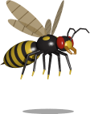
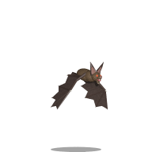
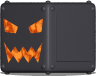
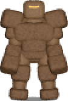

# Monsters

Generated by `npm run doc:monsters` from the game data; do not edit by hand.

Values are those of a monster in game: Game.js creates every monster at level 1, which multiplies vitality and power, and adds 1 to the level of each property.
Effect codes are 7 characters: type, 4-letter subtype, level and duration (base 64, `A` = 0).

- [Myco (`m_myco`)](#myco-m_myco)
- [Spitting Myco (`m_myco2`)](#spitting-myco-m_myco2)
- [`m_myco3`](#m_myco3)
- [Zombie (`m_zombie`)](#zombie-m_zombie)
- [Goblin (`m_goblin`)](#goblin-m_goblin)
- [Goblin Warrior (`m_goblin_warrior`)](#goblin-warrior-m_goblin_warrior)
- [Skeleton (`m_skeleton`)](#skeleton-m_skeleton)
- [Knight (`m_bigarmor`)](#knight-m_bigarmor)
- [`m_zombie_drowned`](#m_zombie_drowned)
- [Acid Blob (`m_acidblob`)](#acid-blob-m_acidblob)
- [Fire Blob (`m_fireblob`)](#fire-blob-m_fireblob)
- [Giant Wasp (`m_wasp`)](#giant-wasp-m_wasp)
- [Raven (`m_raven`)](#raven-m_raven)
- [Bat (`m_bat`)](#bat-m_bat)
- [Giant Spider (`m_spider`)](#giant-spider-m_spider)
- [`m_imp1`](#m_imp1)
- [`m_imp2`](#m_imp2)
- [`m_turret`](#m_turret)
- [Cube (`m_cube`)](#cube-m_cube)
- [`m_phanto`](#m_phanto)
- [`m_pumpkin`](#m_pumpkin)
- [Witch (`m_witch`)](#witch-m_witch)
- [Dark Witch (`m_witch_dark`)](#dark-witch-m_witch_dark)
- [Witch Queen (`m_witch_queen`)](#witch-queen-m_witch_queen)
- [Succubus (`m_succubus`)](#succubus-m_succubus)
- [`m_warlock`](#m_warlock)
- [`m_warlock2`](#m_warlock2)
- [`m_pira`](#m_pira)
- [`m_medusa`](#m_medusa)
- [`m_golem`](#m_golem)
- [Zombie Monarch (`m_zombie_monarch`)](#zombie-monarch-m_zombie_monarch)
- [`m_bigarmorboss`](#m_bigarmorboss)
- [`m_warlockboss`](#m_warlockboss)
- [`m_medusaqueen`](#m_medusaqueen)

## Myco (`m_myco`)

> My first attempt at breeding guards from mushrooms. A failure : it crawls so slowly that a snail would overtake it, and four wounds are enough to squash it. I threw the lot of them out into the forest. Let them be the first thing you meet, and the first thing you underestimate. — *Bestiary : the failed experiments*

### Vitals

| | |
|---|---|
| Thinker | `Rusher` |
| Vitality (hit points) | 4 |
| Move speed | 30 |
| Power | 0 |
| Boss | no |
| Score | 100 |
| Size | 50 × 64 |
| Tile | `m_myco` |

**Behaviour:** charges straight at its target and strikes on contact.

### Resistances and properties

None.

### Equipment

- **Brass dagger (`dag_brass`)**, dagger, one attack every 700 ms
  - slot 0: `slash_brass`
    - projectile `p_slash` (speed 180, range 1), single shot, heavy, energy cost 0
      - Damage (physical) 2-12 `xxphyCA`

### Loot

Number of items: 0 (25 %), 1 (75 %).

| Item | Weight | Per draw |
|---|---|---|
| Gold (`gold`) | 10 | 62.5 % |
| Bread (`ccc_bread`) | 4 | 25 % |
| Raw meat (`ccc_meat`) | 2 | 12.5 % |

### Locations

- `forest[0]` (spawn points 0, 1, 2, 3, 4, 5, 6, 7, 8)

## Spitting Myco (`m_myco2`)

> My second attempt. It still crawls, but now it spits toxic spores from afar. Six wounds to kill, and one spit in five leaves the victim confused, stumbling about like a drunkard. Still a failure. A useful one. — *Bestiary : the failed experiments*

### Vitals

| | |
|---|---|
| Thinker | `Rushooter` |
| Vitality (hit points) | 6 |
| Move speed | 30 |
| Power | 0 |
| Boss | no |
| Score | 100 |
| Size | 50 × 64 |
| Tile | `m_myco2` |

**Behaviour:** charges at its target; at each reaction it has a 25 % chance to fire (only if it sees the target, so never while blind), and strikes on contact.

### Resistances and properties

None.

### Equipment

- **`wand_myco_1`**, wand, one attack every 1000 ms
  - slot 0: `mis_toxicspit_1`
    - projectile `p_toxicspit` (speed 80, range 16), single shot, energy cost 0
      - Damage (toxic) 1-6 `mxtoxBA`
      - Confused over 10 s (20 %) `macnfBK`

### Loot

Number of items: 0 (25 %), 1 (75 %).

| Item | Weight | Per draw |
|---|---|---|
| Gold (`gold`) | 10 | 62.5 % |
| Bread (`ccc_bread`) | 4 | 25 % |
| Raw meat (`ccc_meat`) | 2 | 12.5 % |

### Locations

- `forest[0]` (spawn points 5, 6, 7, 8, 9, 10)

## `m_myco3`

### Vitals

| | |
|---|---|
| Thinker | `Rushooter` |
| Vitality (hit points) | 15 |
| Move speed | 40 |
| Power | 0 |
| Boss | no |
| Score | 200 |
| Size | 50 × 64 |
| Tile | `m_myco3` |

**Behaviour:** charges at its target; at each reaction it has a 25 % chance to fire (only if it sees the target, so never while blind), and strikes on contact.

### Resistances and properties

None.

### Equipment

- **`wand_myco_1`**, wand, one attack every 1000 ms
  - slot 0: `mis_toxicspit_1`
    - projectile `p_toxicspit` (speed 80, range 16), single shot, energy cost 0
      - Damage (toxic) 1-6 `mxtoxBA`
      - Confused over 10 s (20 %) `macnfBK`

### Loot

Number of items: 0 (25 %), 1 (75 %).

| Item | Weight | Per draw |
|---|---|---|
| Gold (`gold`) | 10 | 62.5 % |
| Bread (`ccc_bread`) | 4 | 25 % |
| Raw meat (`ccc_meat`) | 2 | 12.5 % |

### Locations

- `d1[2]` (spawn points 0, 1, 2, 3, 4, 5, 6)

## Zombie (`m_zombie`)

> Death is no excuse to stop working in my service. The corpses of my crypts walk again, slow and stupid, and claw at the living with whatever is left of their hands. Six wounds put one back to rest. Until I wake it up again, of course. — *Bestiary : the undead*

### Vitals

| | |
|---|---|
| Thinker | `Rusher` |
| Vitality (hit points) | 6 |
| Move speed | 80 |
| Power | 0 |
| Boss | no |
| Score | 100 |
| Size | 50 × 64 |
| Tile | `m_zombie` |

**Behaviour:** charges straight at its target and strikes on contact.

### Resistances and properties

None.

### Equipment

- **Brass dagger (`dag_brass`)**, dagger, one attack every 700 ms
  - slot 0: `slash_brass`
    - projectile `p_slash` (speed 180, range 1), single shot, heavy, energy cost 0
      - Damage (physical) 2-12 `xxphyCA`

### Loot

Number of items: 0 (50 %), 1 (50 %).

| Item | Weight | Per draw |
|---|---|---|
| Gold (`gold`) | 6 | 50 % |
| Bread (`ccc_bread`) | 4 | 33.3 % |
| Raw meat (`ccc_meat`) | 2 | 16.7 % |

### Locations

- `crypts[0]` (spawn points 0, 1, 2, 3, 4, 5, 6, 7, 8, 9)
- `crypts[1]` (spawn points 0, 1, 2, 3, 4, 5, 6, 7)
- `crypts[2]` (spawn points 0, 1, 2, 3, 4, 5, 6, 7, 8, 9)
- `mines[2]` (spawn points 0, 1, 2, 3, 4, 5, 6, 7, 8, 9)

## Goblin (`m_goblin`)

> My doorkeepers. Small, greedy, and quick on their feet : they rush at any intruder with a cheap brass dagger. Five honest blows are enough to break one. I keep them for their numbers, not for their brains. If you are reading this, adventurer, they have already failed me. I expected nothing less. — *Bestiary : the goblinoids*

### Vitals

| | |
|---|---|
| Thinker | `Rusher` |
| Vitality (hit points) | 5 |
| Move speed | 100 |
| Power | 0 |
| Boss | no |
| Score | 100 |
| Size | 40 × 64 |
| Tile | `m_goblin` |

**Behaviour:** charges straight at its target and strikes on contact.

### Resistances and properties

None.

### Equipment

- **Brass dagger (`dag_brass`)**, dagger, one attack every 700 ms
  - slot 0: `slash_brass`
    - projectile `p_slash` (speed 180, range 1), single shot, heavy, energy cost 0
      - Damage (physical) 2-12 `xxphyCA`

### Loot

Number of items: 0 (50 %), 1 (50 %).

| Item | Weight | Per draw |
|---|---|---|
| Gold (`gold`) | 8 | 57.1 % |
| Bread (`ccc_bread`) | 4 | 28.6 % |
| Raw meat (`ccc_meat`) | 2 | 14.3 % |

### Locations

- `d1[0]` (spawn points 0, 1, 2, 3, 4, 5, 6, 7, 8, 9)
- `d1[1]` (spawn points 0, 1, 2, 3, 4, 5, 6)

## Goblin Warrior (`m_goblin_warrior`)

> A goblin who survived long enough to steal some armour. Twelve wounds before it falls, but the same brass dagger and the same lack of imagination. They guard the upper halls of my keep. Do not flatter yourself if you beat a few of them : I breed them by the hundred. — *Bestiary : the goblinoids*

### Vitals

| | |
|---|---|
| Thinker | `Rusher` |
| Vitality (hit points) | 12 |
| Move speed | 100 |
| Power | 0 |
| Boss | no |
| Score | 150 |
| Size | 50 × 64 |
| Tile | `m_goblin_warrior` |

**Behaviour:** charges straight at its target and strikes on contact.

### Resistances and properties

None.

### Equipment

- **Brass dagger (`dag_brass`)**, dagger, one attack every 700 ms
  - slot 0: `slash_brass`
    - projectile `p_slash` (speed 180, range 1), single shot, heavy, energy cost 0
      - Damage (physical) 2-12 `xxphyCA`

### Loot

Number of items: 0 (50 %), 1 (50 %).

| Item | Weight | Per draw |
|---|---|---|
| Gold (`gold`) | 10 | 62.5 % |
| Bread (`ccc_bread`) | 4 | 25 % |
| Raw meat (`ccc_meat`) | 2 | 12.5 % |

### Locations

- `d1[0]` (spawn points 7, 8, 9, 10)
- `d1[1]` (spawn points 3, 4, 5, 6, 7, 8, 9, 10)

## Skeleton (`m_skeleton`)

> Once the flesh has rotted away, what remains is lighter, harder and far more obedient. My skeletons take fifteen wounds before they crumble, and you will find them everywhere : crypts, mines, deep halls. Bones are cheap. Your bones will do, too. — *Bestiary : the undead*

### Vitals

| | |
|---|---|
| Thinker | `Rusher` |
| Vitality (hit points) | 15 |
| Move speed | 100 |
| Power | 0 |
| Boss | no |
| Score | 150 |
| Size | 50 × 64 |
| Tile | `m_skeleton` |

**Behaviour:** charges straight at its target and strikes on contact.

### Resistances and properties

None.

### Equipment

- **Brass dagger (`dag_brass`)**, dagger, one attack every 700 ms
  - slot 0: `slash_brass`
    - projectile `p_slash` (speed 180, range 1), single shot, heavy, energy cost 0
      - Damage (physical) 2-12 `xxphyCA`

### Loot

Number of items: 0 (50 %), 1 (50 %).

| Item | Weight | Per draw |
|---|---|---|
| Gold (`gold`) | 6 | 50 % |
| Bread (`ccc_bread`) | 4 | 33.3 % |
| Raw meat (`ccc_meat`) | 2 | 16.7 % |

### Locations

- `d2[0]` (spawn points 0, 1, 2, 3, 4, 5, 6)
- `crypts[0]` (spawn points 6, 7, 8, 9, 10)
- `crypts[1]` (spawn points 3, 4, 5, 6, 7, 8, 9, 10)
- `crypts[2]` (spawn points 0, 1, 2, 3, 4, 5, 6, 7, 8, 9)
- `mines[0]` (spawn points 3, 4, 5, 6, 7, 8, 9)
- `mines[1]` (spawn points 0, 1, 2, 3, 4, 5, 6, 7, 8, 9)
- `mines[2]` (spawn points 0, 1, 2, 3, 4, 5, 6, 7, 8, 9)

## Knight (`m_bigarmor`)

> A suit of black armour bound to a burning soul. It is slow, but its steel blade cuts deep, and daggers and fists barely dent its plates : twenty-five wounds, and most of them wasted. Its one weakness is lightning, which runs through the metal. Not that you will think of it in time. — *Bestiary : the infernal creatures*

### Vitals

| | |
|---|---|
| Thinker | `Rusher` |
| Vitality (hit points) | 25 |
| Move speed | 70 |
| Power | 0 |
| Boss | no |
| Score | 200 |
| Size | 50 × 64 |
| Tile | `m_bigarmor` |

**Behaviour:** charges straight at its target and strikes on contact.

### Resistances and properties

- Armor +3 `nrphyD/` (data: `nrphyC/`, +1 for the monster level)
- vele `nveleD/` (data: `nveleC/`, +1 for the monster level)

### Equipment
puis je te décrire l'ambiance au bureau ce matin ? l'état émotionel des collègue.
- **Steel dagger (`dag_steel`)**, dagger, one attack every 700 ms
  - slot 0: `slash_steel`
    - projectile `p_slash` (speed 180, range 1), single shot, heavy, energy cost 0
      - Damage (physical) 3-18 `xxphyDA`

### Loot

Number of items: 0 (50 %), 1 (50 %).

| Item | Weight | Per draw |
|---|---|---|
| Gold (`gold`) | 10 | 62.5 % |
| Bread (`ccc_bread`) | 4 | 25 % |
| Raw meat (`ccc_meat`) | 2 | 12.5 % |

### Locations

- `d2[0]` (spawn points 0, 1, 2, 3, 4, 5, 6)
- `hellkeep[0]` (spawn points 5, 6, 7, 8, 9, 10)
- `hellkeep[1]` (spawn points 0, 1, 2, 3, 4, 5, 6, 7, 8, 9, 10)

## `m_zombie_drowned`

### Vitals

| | |
|---|---|
| Thinker | `Rusher` |
| Vitality (hit points) | 30 |
| Move speed | 60 |
| Power | 0 |
| Boss | no |
| Score | 200 |
| Size | 50 × 64 |
| Tile | `m_zombie_drowned` |

**Behaviour:** charges straight at its target and strikes on contact.

### Resistances and properties

- Resist Toxic +3 `nrtoxD/` (data: `nrtoxC/`, +1 for the monster level)

### Equipment

- **Steel dagger (`dag_steel`)**, dagger, one attack every 700 ms
  - slot 0: `slash_steel`
    - projectile `p_slash` (speed 180, range 1), single shot, heavy, energy cost 0
      - Damage (physical) 3-18 `xxphyDA`

### Loot

Number of items: 0 (50 %), 1 (50 %).

| Item | Weight | Per draw |
|---|---|---|
| Gold (`gold`) | 10 | 62.5 % |
| Bread (`ccc_bread`) | 4 | 25 % |
| Raw meat (`ccc_meat`) | 2 | 12.5 % |

### Locations

- `medusa[1]` (spawn points 0, 1, 2, 3, 4, 5, 6, 7, 8, 9, 10)

## Acid Blob (`m_acidblob`)

> I wanted a living potion. I got a bag of acid with a mind of its own, ten wounds deep, immune to most poisons. It rushes at you and bursts, splashing acid all around, on you and on anything else near it. Kill it from afar, if you can. I keep mine well away from my laboratory. — *Bestiary : the failed experiments*

### Vitals

| | |
|---|---|
| Thinker | `Boomer` |
| Vitality (hit points) | 10 |
| Move speed | 80 |
| Power | 0 |
| Boss | no |
| Score | 250 |
| Size | 40 × 64 |
| Tile | `m_acidblob` |

**Behaviour:** charges at its target and explodes on contact (its weapon is the explosion), dying in the blast.

### Resistances and properties

- Resist Toxic +3 `nrtoxD/` (data: `nrtoxC/`, +1 for the monster level)

### Equipment

- **`wand_booma_1`**, wand, one attack every 50 ms
  - slot 0: `mis_boomacid_1`, charge 250 ms
    - projectile `p_exptoxic` (speed 20, range 0), single shot, area of effect (radius 4 half-cells), heavy, energy cost 0
      - Damage (toxic) 5-30 `axtoxFA`

### Loot

Number of items: 0 (50 %), 1 (50 %).

| Item | Weight | Per draw |
|---|---|---|
| Gold (`gold`) | 10 | 62.5 % |
| Bread (`ccc_bread`) | 4 | 25 % |
| Raw meat (`ccc_meat`) | 2 | 12.5 % |

### Locations

- `d1[1]` (spawn points 2, 3, 4, 5, 6, 7, 8, 9)
- `d1[2]` (spawn points 3, 4, 5, 6, 7, 8, 9)

## Fire Blob (`m_fireblob`)

> The acid blob's brother, filled with liquid fire instead. Same ten wounds, same charge, same burst : but this one sets everything around it ablaze, and fire does not trouble it much. I find them delightful. From a distance. — *Bestiary : the failed experiments*

### Vitals

| | |
|---|---|
| Thinker | `Boomer` |
| Vitality (hit points) | 10 |
| Move speed | 80 |
| Power | 0 |
| Boss | no |
| Score | 250 |
| Size | 40 × 64 |
| Tile | `m_fireblob` |

**Behaviour:** charges at its target and explodes on contact (its weapon is the explosion), dying in the blast.

### Resistances and properties

- Resist Fire +3 `nrfirD/` (data: `nrfirC/`, +1 for the monster level)

### Equipment

- **`wand_boomf_1`**, wand, one attack every 50 ms
  - slot 0: `mis_boomfire_1`, charge 250 ms
    - projectile `p_expfire` (speed 20, range 0), single shot, area of effect (radius 4 half-cells), heavy, energy cost 0
      - Damage (fire) 5-30 `axfirFA`

### Loot

Number of items: 0 (50 %), 1 (50 %).

| Item | Weight | Per draw |
|---|---|---|
| Gold (`gold`) | 10 | 62.5 % |
| Bread (`ccc_bread`) | 4 | 25 % |
| Raw meat (`ccc_meat`) | 2 | 12.5 % |

### Locations

- `d1[3]` (spawn points 7, 8, 9)
- `d2[0]` (spawn points 3, 4, 5, 6, 7, 8, 9)

## Giant Wasp (`m_wasp`)

> I fed the common wasp on alchemical honey. The result darts in, stings, and darts away before you can strike back. Its body is fragile, three wounds at most, but one sting in four leaves a poison in the blood. A fitting welcome for uninvited guests. — *Bestiary : the creepers*

### Vitals

| | |
|---|---|
| Thinker | `Dasher` |
| Vitality (hit points) | 3 |
| Move speed | 80 |
| Power | 0 |
| Boss | no |
| Score | 150 |
| Size | 25 × 64 |
| Tile | `m_wasp` |

**Behaviour:** darts forward three steps at a time, stings on contact, and veers off when it bumps into a wall or another monster.

### Resistances and properties

None.

### Equipment

- **`dag_poisonsting_1`**, dagger, one attack every 700 ms
  - slot 0: `slash_poison_1`
    - projectile `p_slash` (speed 180, range 1), single shot, heavy, energy cost 0
      - Damage (physical) 2-12 `axphyCA`
      - Damage (toxic) 10 over 5 s (25 %) `pxtoxCF`

### Loot

Number of items: 0 (75 %), 1 (25 %).

| Item | Weight | Per draw |
|---|---|---|
| Cooking herbs (`ccc_herb0`) | 1 | 33.3 % |
| Medicinal herbs (`ccc_herb1`) | 2 | 66.7 % |

### Locations

- `d1[0]` (spawn points 4, 5, 6, 7, 8, 9)
- `d1[1]` (spawn points 7, 8, 9)
- `d1[2]` (spawn points 0, 1, 2, 3, 4, 5, 6, 7, 8)

## Raven (`m_raven`)

> My favourite pet, and the only creature here with a sense of humour. It does not fight to kill : it pecks, then flies off with something from your bag. A trinket, a ring, an amulet... Everything it steals comes back to me. Thank you for your gifts. — *Bestiary : the creepers*

### Vitals

| | |
|---|---|
| Thinker | `Stealer` |
| Vitality (hit points) | 4 |
| Move speed | 100 |
| Power | 0 |
| Boss | no |
| Score | 200 |
| Size | 30 × 64 |
| Tile | `m_raven` |

**Behaviour:** flies at its target, steals once on contact (gold, rings, earrings, weighted 7/2/1 among what you carry) and then fights.

### Resistances and properties

None.

### Equipment

- **`dag_ravenbeak_1`**, dagger, one attack every 700 ms
  - slot 0: `slash_ravenbeak_1`
    - projectile `p_slash` (speed 180, range 1), single shot, heavy, energy cost 0
      - Damage (physical) 2-12 `axphyCA`

### Loot

Number of items: 0 (50 %), 1 (50 %).

| Item | Weight | Per draw |
|---|---|---|
| Gold (`gold`) | 10 | 62.5 % |
| Bread (`ccc_bread`) | 4 | 25 % |
| Raw meat (`ccc_meat`) | 2 | 12.5 % |

### Locations

- `d1[3]` (spawn points 0, 1, 2, 3, 4, 5, 6)
- `coven[0]` (spawn points 0, 1, 2, 3, 4, 5, 6, 7, 8, 9)

## Bat (`m_bat`)

> A tiny thing, as frail as the raven, that the witches keep in their coven. It never flies straight : it flutters left and right in a mad zigzag and bites when you finally lose track of it. Swing at it as much as you like. You will mostly hit the air. — *Bestiary : the creepers*

### Vitals

| | |
|---|---|
| Thinker | `Wavedasher` |
| Vitality (hit points) | 4 |
| Move speed | 90 |
| Power | 0 |
| Boss | no |
| Score | 150 |
| Size | 30 × 64 |
| Tile | `m_bat` |

**Behaviour:** a dasher that weaves: it turns by a random angle at each reaction.

### Resistances and properties

None.

### Equipment

- **Brass dagger (`dag_brass`)**, dagger, one attack every 700 ms
  - slot 0: `slash_brass`
    - projectile `p_slash` (speed 180, range 1), single shot, heavy, energy cost 0
      - Damage (physical) 2-12 `xxphyCA`

### Loot

Number of items: 0 (75 %), 1 (25 %).

| Item | Weight | Per draw |
|---|---|---|
| Gold (`gold`) | 10 | 90.9 % |
| Cooking herbs (`ccc_herb0`) | 1 | 9.1 % |

### Locations

- `coven[0]` (spawn points 0, 1, 2, 3, 4, 5, 6, 7, 8, 9)

## Giant Spider (`m_spider`)

> The fastest thing that crawls in my crypts and my mines, far faster than you. Its venomous bite is the same as the wasp's, and it never lets go. Six wounds will kill it, if you can hit it. Most visitors die trying to run away from it. — *Bestiary : the creepers*

### Vitals

| | |
|---|---|
| Thinker | `Rusher` |
| Vitality (hit points) | 6 |
| Move speed | 140 |
| Power | 0 |
| Boss | no |
| Score | 250 |
| Size | 40 × 64 |
| Tile | `m_spider` |

**Behaviour:** charges straight at its target and strikes on contact.

### Resistances and properties

None.

### Equipment

- **`dag_poisonsting_1`**, dagger, one attack every 700 ms
  - slot 0: `slash_poison_1`
    - projectile `p_slash` (speed 180, range 1), single shot, heavy, energy cost 0
      - Damage (physical) 2-12 `axphyCA`
      - Damage (toxic) 10 over 5 s (25 %) `pxtoxCF`

### Loot

Number of items: 0 (25 %), 1 (75 %).

| Item | Weight | Per draw |
|---|---|---|
| Gold (`gold`) | 10 | 62.5 % |
| Bread (`ccc_bread`) | 4 | 25 % |
| Raw meat (`ccc_meat`) | 2 | 12.5 % |

### Locations

- `crypts[0]` (spawn points 0, 1, 2, 3, 4)
- `crypts[1]` (spawn points 0, 1, 2, 3, 4, 5, 6, 7, 8, 9)
- `mines[0]` (spawn points 0, 1, 2, 3, 4, 5, 6, 7, 8, 9)

## `m_imp1`

### Vitals

| | |
|---|---|
| Thinker | `Shooter` |
| Vitality (hit points) | 13 |
| Move speed | 100 |
| Power | 0 |
| Boss | no |
| Score | 300 |
| Size | 35 × 64 |
| Tile | `m_imp1` |

**Behaviour:** keeps its distance: backs away when closer than one cell, strafes left or right at 1 to 3 cells, walks in from farther. Fires with a 33 % chance per reaction when close, 40 % at mid range.

### Resistances and properties

None.

### Equipment

- **`wand_imp_1`**, wand, one attack every 500 ms
  - slot 0: `mis_impwand_1`
    - projectile `p_shadbolt` (speed 180, range 30), single shot, energy cost 0
      - Damage (arcane) 4-24 `mxmagEA`
  - slot 1: `mis_heal_1`, charge 100 ms
    - projectile `p_healbolt` (speed 180, range 30), single shot, energy cost 0
      - HP +24 `mrheaEA`

### Loot

Number of items: 0 (50 %), 1 (50 %).

| Item | Weight | Per draw |
|---|---|---|
| Gold (`gold`) | 10 | 62.5 % |
| Bread (`ccc_bread`) | 4 | 25 % |
| Raw meat (`ccc_meat`) | 2 | 12.5 % |

### Locations

- `d1[2]` (spawn points 7, 8, 9, 10)
- `mines[0]` (spawn points 7, 8, 9, 10)
- `mines[1]` (spawn points 3, 4, 5, 6, 7, 8, 9)

## `m_imp2`

### Vitals

| | |
|---|---|
| Thinker | `Healer` |
| Vitality (hit points) | 11 |
| Move speed | 120 |
| Power | 0 |
| Boss | no |
| Score | 300 |
| Size | 35 × 64 |
| Tile | `m_imp2` |

**Behaviour:** follows its target; at each reaction it heals the most wounded monster within 512 units (cast slot 1), otherwise shoots at the target.

### Resistances and properties

None.

### Equipment

- **`wand_imp_1`**, wand, one attack every 500 ms
  - slot 0: `mis_impwand_1`
    - projectile `p_shadbolt` (speed 180, range 30), single shot, energy cost 0
      - Damage (arcane) 4-24 `mxmagEA`
  - slot 1: `mis_heal_1`, charge 100 ms
    - projectile `p_healbolt` (speed 180, range 30), single shot, energy cost 0
      - HP +24 `mrheaEA`

### Loot

Number of items: 0 (50 %), 1 (50 %).

| Item | Weight | Per draw |
|---|---|---|
| Gold (`gold`) | 10 | 62.5 % |
| Bread (`ccc_bread`) | 4 | 25 % |
| Raw meat (`ccc_meat`) | 2 | 12.5 % |

### Locations

- `d1[2]` (spawn points 7, 8, 9, 10)
- `mines[1]` (spawn points 7, 8, 9, 10)

## `m_turret`

### Vitals

| | |
|---|---|
| Thinker | `Sentry` |
| Vitality (hit points) | 30 |
| Move speed | 0 |
| Power | 0 |
| Boss | no |
| Score | 300 |
| Size | 40 × 64 |
| Tile | `m_turret` |

**Behaviour:** never walks or wanders; turns towards its target and fires.

### Resistances and properties

- Armor +3 `nrphyD/` (data: `nrphyC/`, +1 for the monster level)

### Equipment

- **`wand_turret_1`**, wand, one attack every 500 ms
  - slot 0: `mis_turretfire_1`
    - projectile `p_firebolt` (speed 180, range 30), single shot, energy cost 0
      - Damage (fire) 3-18 `mxfirDA`

### Loot

Number of items: 0 (25 %), 1 (75 %).

| Item | Weight | Per draw |
|---|---|---|
| Gold (`gold`) | 10 | 62.5 % |
| Bread (`ccc_bread`) | 4 | 25 % |
| Raw meat (`ccc_meat`) | 2 | 12.5 % |

### Locations

- `d1[3]` (spawn points 3, 4, 5, 6)

## Cube (`m_cube`)

> I opened a door to the Pit, and this came through first. A floating block of infernal stone that spits three fireballs at a time, and the fireballs bounce off the walls. Ten wounds will crack it. Corners will not save you. — *Bestiary : the infernal creatures*

### Vitals

| | |
|---|---|
| Thinker | `Rushooter` |
| Vitality (hit points) | 10 |
| Move speed | 70 |
| Power | 0 |
| Boss | no |
| Score | 300 |
| Size | 25 × 64 |
| Tile | `m_cube` |

**Behaviour:** charges at its target; at each reaction it has a 25 % chance to fire (only if it sees the target, so never while blind), and strikes on contact.

### Resistances and properties

None.

### Equipment

- **`wand_cube_1`**, wand, one attack every 1000 ms
  - slot 0: `mis_cubefire_2`
    - projectile `p_fireball` (speed 180, range 30), triple fan (0, ±0.2 rad), bounces off walls, energy cost 0
      - Damage (fire) 2-12 `mxfirCA`

### Loot

Number of items: 0 (25 %), 1 (75 %).

| Item | Weight | Per draw |
|---|---|---|
| Gold (`gold`) | 10 | 62.5 % |
| Bread (`ccc_bread`) | 4 | 25 % |
| Raw meat (`ccc_meat`) | 2 | 12.5 % |

### Locations

- `d1[3]` (spawn points 7, 8, 9, 10)
- `hellkeep[0]` (spawn points 3, 4, 5, 6, 7, 8, 9)
- `hellkeep[1]` (spawn points 6, 7, 8, 9, 10)
- `mines[1]` (spawn points 7, 8, 9, 10)

## `m_phanto`

### Vitals

| | |
|---|---|
| Thinker | `Shooter` |
| Vitality (hit points) | 30 |
| Move speed | 200 |
| Power | 0 |
| Boss | no |
| Score | 500 |
| Size | 35 × 64 |
| Tile | `m_phanto` |

**Behaviour:** keeps its distance: backs away when closer than one cell, strafes left or right at 1 to 3 cells, walks in from farther. Fires with a 33 % chance per reaction when close, 40 % at mid range.

### Resistances and properties

None.

### Equipment

- **`wand_imp_1`**, wand, one attack every 500 ms
  - slot 0: `mis_impwand_1`
    - projectile `p_shadbolt` (speed 180, range 30), single shot, energy cost 0
      - Damage (arcane) 4-24 `mxmagEA`
  - slot 1: `mis_heal_1`, charge 100 ms
    - projectile `p_healbolt` (speed 180, range 30), single shot, energy cost 0
      - HP +24 `mrheaEA`

### Loot

Number of items: 0 (25 %), 1 (75 %).

| Item | Weight | Per draw |
|---|---|---|
| Gold (`gold`) | 10 | 62.5 % |
| Bread (`ccc_bread`) | 4 | 25 % |
| Raw meat (`ccc_meat`) | 2 | 12.5 % |

### Locations

Not placed in any horde (spawned by a level script, or unused).

## `m_pumpkin`

### Vitals

| | |
|---|---|
| Thinker | `Healer` |
| Vitality (hit points) | 25 |
| Move speed | 40 |
| Power | 0 |
| Boss | no |
| Score | 500 |
| Size | 40 × 64 |
| Tile | `m_pumpkin` |

**Behaviour:** follows its target; at each reaction it heals the most wounded monster within 512 units (cast slot 1), otherwise shoots at the target.

### Resistances and properties

None.

### Equipment

- **`wand_imp_1`**, wand, one attack every 500 ms
  - slot 0: `mis_impwand_1`
    - projectile `p_shadbolt` (speed 180, range 30), single shot, energy cost 0
      - Damage (arcane) 4-24 `mxmagEA`
  - slot 1: `mis_heal_1`, charge 100 ms
    - projectile `p_healbolt` (speed 180, range 30), single shot, energy cost 0
      - HP +24 `mrheaEA`

### Loot

Number of items: 0 (25 %), 1 (75 %).

| Item | Weight | Per draw |
|---|---|---|
| Gold (`gold`) | 10 | 62.5 % |
| Bread (`ccc_bread`) | 4 | 25 % |
| Raw meat (`ccc_meat`) | 2 | 12.5 % |

### Locations

- `d2[0]` (spawn points 9, 10)

## Witch (`m_witch`)

> The coven believes it is my ally. I let it believe so. A witch keeps her distance and hurls bolts of lightning, fifteen wounds deep. Their spells are shaped to spare their queen : in a crowded corridor they burst against her without a scratch. Clever, for a witch. — *Bestiary : the coven*

### Vitals

| | |
|---|---|
| Thinker | `Shooter` |
| Vitality (hit points) | 15 |
| Move speed | 90 |
| Power | 0 |
| Boss | no |
| Score | 300 |
| Size | 40 × 64 |
| Tile | `m_witch` |

**Behaviour:** keeps its distance: backs away when closer than one cell, strafes left or right at 1 to 3 cells, walks in from farther. Fires with a 33 % chance per reaction when close, 40 % at mid range.

### Resistances and properties

None.

### Equipment

- **`wand_witch_1`**, wand, one attack every 600 ms
  - slot 0: `mis_witch_1`
    - projectile `p_thunbolt` (speed 180, range 30), single shot, spares bosses (bursts on them harmlessly), energy cost 0
      - Damage (electricity) 2-12 `mxeleCA`

### Loot

Number of items: 0 (50 %), 1 (50 %).

| Item | Weight | Per draw |
|---|---|---|
| Gold (`gold`) | 8 | 57.1 % |
| Bread (`ccc_bread`) | 4 | 28.6 % |
| Raw meat (`ccc_meat`) | 2 | 14.3 % |

### Locations

- `coven[0]` (spawn points 6, 7, 8, 9, 10)
- `coven[1]` (spawn points 0, 1, 2, 3, 4, 5, 6, 7, 8, 9)

## Dark Witch (`m_witch_dark`)

> The same frail body as her sisters, but she has dabbled in shadow : her dark bolts burn the mind, not the flesh. Worse, she mends her sisters' wounds with a healing spell. Kill her first, if you have the wit. And like her sisters, she would never harm her queen. — *Bestiary : the coven*

### Vitals

| | |
|---|---|
| Thinker | `Shooter` |
| Vitality (hit points) | 15 |
| Move speed | 90 |
| Power | 0 |
| Boss | no |
| Score | 300 |
| Size | 40 × 64 |
| Tile | `m_witch_dark` |

**Behaviour:** keeps its distance: backs away when closer than one cell, strafes left or right at 1 to 3 cells, walks in from farther. Fires with a 33 % chance per reaction when close, 40 % at mid range.

### Resistances and properties

None.

### Equipment

- **`wand_witch_dark_1`**, wand, one attack every 500 ms
  - slot 0: `mis_witch_dark_1`
    - projectile `p_shadbolt` (speed 180, range 30), single shot, spares bosses (bursts on them harmlessly), energy cost 0
      - Damage (arcane) 4-24 `mxmagEA`
  - slot 1: `mis_heal_1`, charge 100 ms
    - projectile `p_healbolt` (speed 180, range 30), single shot, energy cost 0
      - HP +24 `mrheaEA`

### Loot

Number of items: 0 (50 %), 1 (50 %).

| Item | Weight | Per draw |
|---|---|---|
| Gold (`gold`) | 8 | 57.1 % |
| Bread (`ccc_bread`) | 4 | 28.6 % |
| Raw meat (`ccc_meat`) | 2 | 14.3 % |

### Locations

- `coven[0]` (spawn points 6, 7, 8, 9, 10)
- `coven[1]` (spawn points 0, 1, 2, 3, 4, 5, 6, 7, 8, 9)

## Witch Queen (`m_witch_queen`)

> The queen of the coven calls herself my equal. Amusing. Sixty wounds, a skin that shrugs off magic and lightning, and three toxic bolts at once from her throne. While she lives, the way out of her throne room stays sealed. I would almost wish you luck. Almost. — *Bestiary : the coven*

### Vitals

| | |
|---|---|
| Thinker | `Caster` |
| Vitality (hit points) | 60 |
| Move speed | 90 |
| Power | 0 |
| Boss | yes (seals the level exit until killed) |
| Score | 800 |
| Size | 40 × 64 |
| Tile | `m_witch_queen` |

**Behaviour:** moves like a shooter (backs away, strafes, walks in). Each cast first tries its magic spells (data.casts), then its wand slots: 40 % slot 0, 30 % slot 1, 20 % slot 2, 10 % slot 3 (missing slots fall back to slot 0).

### Resistances and properties

- Resist Magic +3 `nrmagD/` (data: `nrmagC/`, +1 for the monster level)
- Resist Electricity +5 `nreleF/` (data: `nreleE/`, +1 for the monster level)

### Equipment

- **`wand_witch_queen_1`**, wand, one attack every 700 ms
  - slot 0: `mis_witch_queen_1`
    - projectile `p_toxicbolt` (speed 180, range 30), triple fan (0, ±0.2 rad), energy cost 0
      - Damage (toxic) 3-18 `mxtoxDA`
      - Confused over 10 s (20 %) `macnfBK`
- **When wounded:** casts Reflect on itself, at most once every 30 s (MEDIUM)
- **Magic:** Teleport, 25 % per cast, cooldown 8 s, 400 ms incantation

### Loot

Number of items: 1 (100 %).

| Item | Weight | Per draw |
|---|---|---|
| Wand of Energy (`wand_lyte_3`) | 1 | 100 % |

### Locations

- `coven[1]` (spawn points 10)

## Succubus (`m_succubus`)

> The most charming guest of my infernal keep. Quick on her feet, she keeps her distance and hurls fireballs, twenty-five wounds deep. Fire is her element : she shrugs off half the damage of any flame you throw at her. Bring something colder. Or do not come at all. — *Bestiary : the infernal creatures*

### Vitals

| | |
|---|---|
| Thinker | `Shooter` |
| Vitality (hit points) | 25 |
| Move speed | 110 |
| Power | 0 |
| Boss | no |
| Score | 400 |
| Size | 40 × 64 |
| Tile | `m_succubus` |

**Behaviour:** keeps its distance: backs away when closer than one cell, strafes left or right at 1 to 3 cells, walks in from farther. Fires with a 33 % chance per reaction when close, 40 % at mid range.

### Resistances and properties

- Resist Fire +9 `nrfirJ/` (data: `nrfirI/`, +1 for the monster level)

### Equipment

- **`wand_succubus_1`**, wand, one attack every 600 ms
  - slot 0: `mis_succubus_1`
    - projectile `p_fireball` (speed 180, range 30), single shot, energy cost 0
      - Damage (fire) 3-18 `mxfirDA`

### Loot

Number of items: 0 (50 %), 1 (50 %).

| Item | Weight | Per draw |
|---|---|---|
| Gold (`gold`) | 10 | 62.5 % |
| Bread (`ccc_bread`) | 4 | 25 % |
| Raw meat (`ccc_meat`) | 2 | 12.5 % |

### Locations

- `hellkeep[0]` (spawn points 0, 1, 2, 3, 4, 5, 6)
- `hellkeep[1]` (spawn points 0, 1, 2, 3, 4, 5, 6, 7, 8, 9)
- `hellkeep[2]` (spawn points 0, 1, 2, 3, 4, 5, 6, 7, 8, 9)

## `m_warlock`

### Vitals

| | |
|---|---|
| Thinker | `Shooter` |
| Vitality (hit points) | 25 |
| Move speed | 80 |
| Power | 0 |
| Boss | no |
| Score | 400 |
| Size | 40 × 64 |
| Tile | `m_warlock` |

**Behaviour:** keeps its distance: backs away when closer than one cell, strafes left or right at 1 to 3 cells, walks in from farther. Fires with a 33 % chance per reaction when close, 40 % at mid range.

### Resistances and properties

None.

### Equipment

- **`wand_warlock_1`**, wand, one attack every 500 ms
  - slot 0: `mis_warlock_1`
    - projectile `p_magbolt` (speed 180, range 30), single shot, energy cost 0
      - Damage (arcane) 2-12 `mxmagCA`
      - Blind over 5 s (10 %) `mabldBF`
      - Vulnerability +2 over 5 s (25 %) `mavulCF`
      - Healing efficiency -2 over 5 s (20 %) `maillCF`

### Loot

Number of items: 0 (25 %), 1 (75 %).

| Item | Weight | Per draw |
|---|---|---|
| Gold (`gold`) | 10 | 62.5 % |
| Bread (`ccc_bread`) | 4 | 25 % |
| Raw meat (`ccc_meat`) | 2 | 12.5 % |

### Locations

- `d2[0]` (spawn points 7, 8, 9, 10)
- `d2[1]` (spawn points 0, 1, 2, 3, 4, 5, 6, 7, 8, 9)

## `m_warlock2`

### Vitals

| | |
|---|---|
| Thinker | `Shooter` |
| Vitality (hit points) | 25 |
| Move speed | 80 |
| Power | 0 |
| Boss | no |
| Score | 400 |
| Size | 40 × 64 |
| Tile | `m_warlock2` |

**Behaviour:** keeps its distance: backs away when closer than one cell, strafes left or right at 1 to 3 cells, walks in from farther. Fires with a 33 % chance per reaction when close, 40 % at mid range.

### Resistances and properties

None.

### Equipment

- **`wand_warlock_1`**, wand, one attack every 500 ms
  - slot 0: `mis_warlock_1`
    - projectile `p_magbolt` (speed 180, range 30), single shot, energy cost 0
      - Damage (arcane) 2-12 `mxmagCA`
      - Blind over 5 s (10 %) `mabldBF`
      - Vulnerability +2 over 5 s (25 %) `mavulCF`
      - Healing efficiency -2 over 5 s (20 %) `maillCF`

### Loot

Number of items: 0 (25 %), 1 (75 %).

| Item | Weight | Per draw |
|---|---|---|
| Gold (`gold`) | 10 | 62.5 % |
| Bread (`ccc_bread`) | 4 | 25 % |
| Raw meat (`ccc_meat`) | 2 | 12.5 % |

### Locations

- `d2[1]` (spawn points 0, 1, 2, 3, 4, 5, 6, 7, 8, 9)

## `m_pira`

### Vitals

| | |
|---|---|
| Thinker | `Wavedasher` |
| Vitality (hit points) | 15 |
| Move speed | 90 |
| Power | 0 |
| Boss | no |
| Score | 100 |
| Size | 40 × 64 |
| Tile | `m_pira` |

**Behaviour:** a dasher that weaves: it turns by a random angle at each reaction.

### Resistances and properties

None.

### Equipment

- **Brass dagger (`dag_brass`)**, dagger, one attack every 700 ms
  - slot 0: `slash_brass`
    - projectile `p_slash` (speed 180, range 1), single shot, heavy, energy cost 0
      - Damage (physical) 2-12 `xxphyCA`

### Loot

Number of items: 0 (25 %), 1 (75 %).

| Item | Weight | Per draw |
|---|---|---|
| Gold (`gold`) | 10 | 62.5 % |
| Bread (`ccc_bread`) | 4 | 25 % |
| Raw meat (`ccc_meat`) | 2 | 12.5 % |

### Locations

- `medusa[1]` (spawn points 0, 1, 2, 3, 4, 5, 6, 7, 8, 9, 10)

## `m_medusa`

### Vitals

| | |
|---|---|
| Thinker | `Rushooter` |
| Vitality (hit points) | 15 |
| Move speed | 40 |
| Power | 0 |
| Boss | no |
| Score | 250 |
| Size | 40 × 64 |
| Tile | `m_medusa` |

**Behaviour:** charges at its target; at each reaction it has a 25 % chance to fire (only if it sees the target, so never while blind), and strikes on contact.

### Resistances and properties

- bant `nbantI/` (data: `nbantH/`, +1 for the monster level)

### Equipment

- **`wand_medusa_1`**, wand, one attack every 1000 ms
  - slot 0: `mis_medtoxic_2`
    - projectile `p_medbolt` (speed 100, range 30), single wave (sine), energy cost 0
      - Damage (physical) 4-24 `mxphyEA`
      - Damage (toxic) 40 over 20 s `pxtoxCU`

### Loot

Number of items: 0 (25 %), 1 (75 %).

| Item | Weight | Per draw |
|---|---|---|
| Gold (`gold`) | 10 | 62.5 % |
| Bread (`ccc_bread`) | 4 | 25 % |
| Raw meat (`ccc_meat`) | 2 | 12.5 % |

### Locations

- `medusa[1]` (spawn points 0, 1, 2, 3, 4, 5, 6, 7, 8, 9, 10)
- `medusa[2]` (spawn points 0, 1, 2, 3, 4, 5, 6, 7, 8, 9)

## `m_golem`

### Vitals

| | |
|---|---|
| Thinker | `Rusher` |
| Vitality (hit points) | 300 |
| Move speed | 160 |
| Power | 0 |
| Boss | yes (seals the level exit until killed) |
| Score | 3000 |
| Size | 50 × 64 |
| Tile | `m_golem` |

**Behaviour:** charges straight at its target and strikes on contact.

### Resistances and properties

- Armor +5 `nrphyF/` (data: `nrphyE/`, +1 for the monster level)

### Equipment

- **`dag_golem`**, dagger, one attack every 700 ms
  - slot 0: `punch_golem`
    - projectile `p_slash` (speed 180, range 1), single shot, heavy, energy cost 0
      - Damage (physical) 6-36 `xxphyGA`

### Loot

Number of items: 0 (25 %), 1 (75 %).

| Item | Weight | Per draw |
|---|---|---|
| Gold (`gold`) | 16 | 72.7 % |
| Bread (`ccc_bread`) | 4 | 18.2 % |
| Raw meat (`ccc_meat`) | 2 | 9.1 % |

### Locations

- `mines[2]` (spawn points 10)

## Zombie Monarch (`m_zombie_monarch`)

> He was a king, once, and he ruled these lands before I came. Now he rules only my crypts, as my slave. Two hundred wounds, a steel blade, and a grudge against every living thing. While he stands, the gate of his throne room stays sealed. It will stay sealed forever, I suspect. — *Bestiary : the undead*

### Vitals

| | |
|---|---|
| Thinker | `Rusher` |
| Vitality (hit points) | 200 |
| Move speed | 100 |
| Power | 0 |
| Boss | yes (seals the level exit until killed) |
| Score | 1000 |
| Size | 50 × 64 |
| Tile | `m_zombie_monarch` |

**Behaviour:** charges straight at its target and strikes on contact.

### Resistances and properties

None.

### Equipment

- **Steel dagger (`dag_steel`)**, dagger, one attack every 700 ms
  - slot 0: `slash_steel`
    - projectile `p_slash` (speed 180, range 1), single shot, heavy, energy cost 0
      - Damage (physical) 3-18 `xxphyDA`

### Loot

Number of items: 0 (25 %), 1 (75 %).

| Item | Weight | Per draw |
|---|---|---|
| Gold (`gold`) | 10 | 62.5 % |
| Bread (`ccc_bread`) | 4 | 25 % |
| Raw meat (`ccc_meat`) | 2 | 12.5 % |

### Locations

- `crypts[2]` (spawn points 10)

## `m_bigarmorboss`

### Vitals

| | |
|---|---|
| Thinker | `Rusher` |
| Vitality (hit points) | 220 |
| Move speed | 100 |
| Power | 0 |
| Boss | yes (seals the level exit until killed) |
| Score | 3000 |
| Size | 50 × 64 |
| Tile | `m_bigarmorboss` |

**Behaviour:** charges straight at its target and strikes on contact.

### Resistances and properties

- Armor +5 `nrphyF/` (data: `nrphyE/`, +1 for the monster level)

### Equipment

- **Steel dagger (`dag_steel`)**, dagger, one attack every 700 ms
  - slot 0: `slash_steel`
    - projectile `p_slash` (speed 180, range 1), single shot, heavy, energy cost 0
      - Damage (physical) 3-18 `xxphyDA`

### Loot

Number of items: 0 (25 %), 1 (75 %).

| Item | Weight | Per draw |
|---|---|---|
| Gold (`gold`) | 10 | 62.5 % |
| Bread (`ccc_bread`) | 4 | 25 % |
| Raw meat (`ccc_meat`) | 2 | 12.5 % |

### Locations

- `hellkeep[2]` (spawn points 10)

## `m_warlockboss`

### Vitals

| | |
|---|---|
| Thinker | `Shooter` |
| Vitality (hit points) | 200 |
| Move speed | 100 |
| Power | 0 |
| Boss | yes (seals the level exit until killed) |
| Score | 5000 |
| Size | 40 × 64 |
| Tile | `m_warlockboss` |

**Behaviour:** keeps its distance: backs away when closer than one cell, strafes left or right at 1 to 3 cells, walks in from farther. Fires with a 33 % chance per reaction when close, 40 % at mid range.

### Resistances and properties

- Resist Fire +5 `nrfirF/` (data: `nrfirE/`, +1 for the monster level)

### Equipment

- **`wand_warlock_1`**, wand, one attack every 500 ms
  - slot 0: `mis_warlock_1`
    - projectile `p_magbolt` (speed 180, range 30), single shot, energy cost 0
      - Damage (arcane) 2-12 `mxmagCA`
      - Blind over 5 s (10 %) `mabldBF`
      - Vulnerability +2 over 5 s (25 %) `mavulCF`
      - Healing efficiency -2 over 5 s (20 %) `maillCF`

### Loot

Number of items: 0 (25 %), 1 (75 %).

| Item | Weight | Per draw |
|---|---|---|
| Gold (`gold`) | 10 | 62.5 % |
| Bread (`ccc_bread`) | 4 | 25 % |
| Raw meat (`ccc_meat`) | 2 | 12.5 % |

### Locations

- `d2[1]` (spawn points 10)

## `m_medusaqueen`

### Vitals

| | |
|---|---|
| Thinker | `Rushooter` |
| Vitality (hit points) | 200 |
| Move speed | 50 |
| Power | 0 |
| Boss | yes (seals the level exit until killed) |
| Score | 2000 |
| Size | 45 × 64 |
| Tile | `m_medusaqueen` |

**Behaviour:** charges at its target; at each reaction it has a 25 % chance to fire (only if it sees the target, so never while blind), and strikes on contact.

### Resistances and properties

- bant `nbantI/` (data: `nbantH/`, +1 for the monster level)
- HP +189 `nrheaD/` (data: `nrheaC/`, +1 for the monster level)

### Equipment

- **`wand_medusa_1`**, wand, one attack every 1000 ms
  - slot 0: `mis_medtoxic_2`
    - projectile `p_medbolt` (speed 100, range 30), single wave (sine), energy cost 0
      - Damage (physical) 4-24 `mxphyEA`
      - Damage (toxic) 40 over 20 s `pxtoxCU`

### Loot

Number of items: 1 (100 %).

| Item | Weight | Per draw |
|---|---|---|
| Flame ward (`amu_fireward`) | 1 | 100 % |

Always dropped: Ring of elements III (`ring_thermdef_3`).

### Locations

- `medusa[2]` (spawn points 10)
